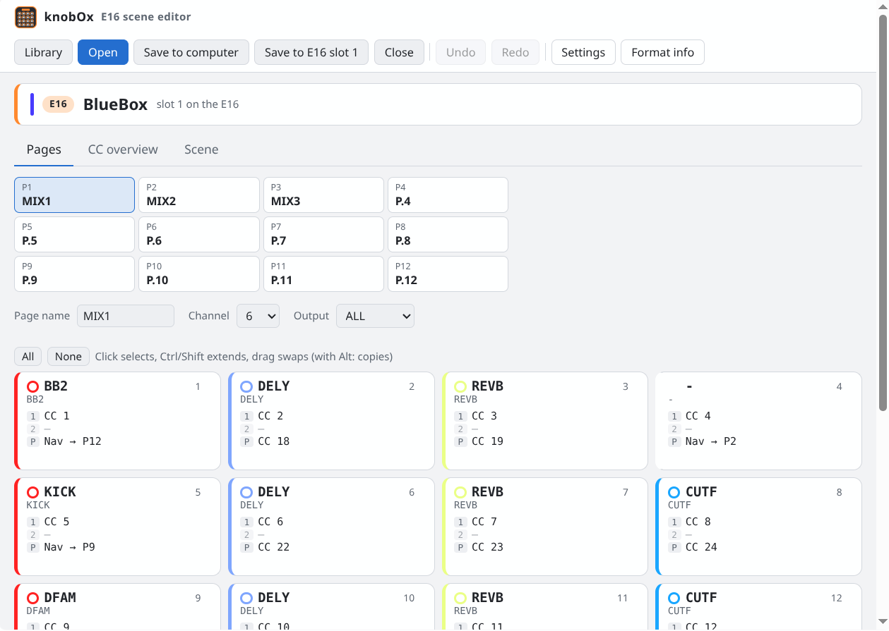
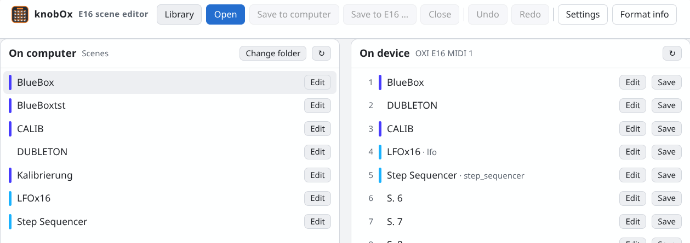
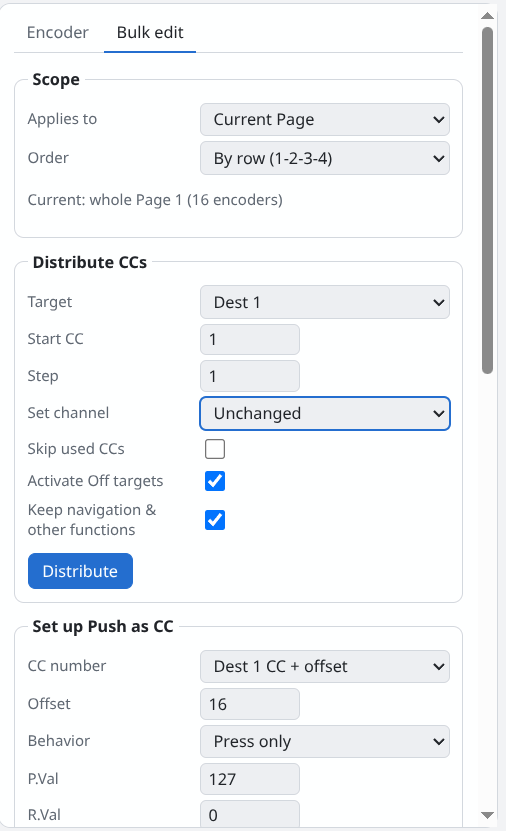
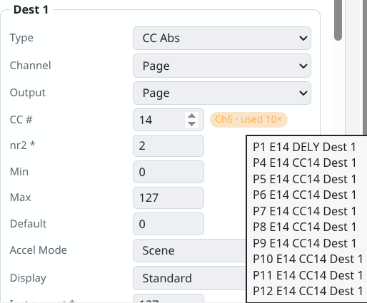
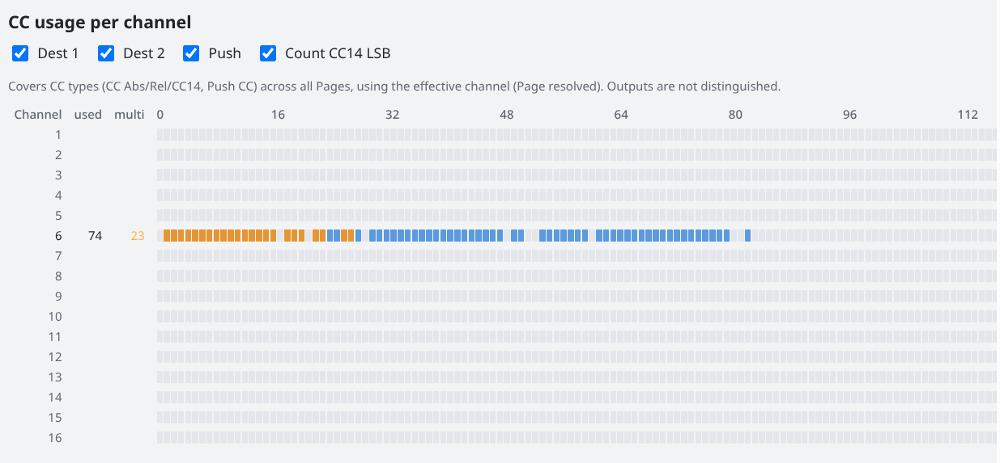
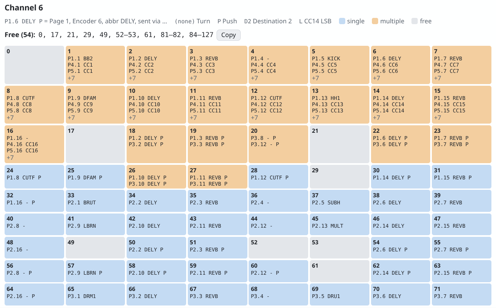

#  knobOx

**knobOx** is an unofficial, browser-based editor for **OXI E16** scene files (`.oxie16`) that can also transfer scenes to and from the device over USB-MIDI. It runs entirely in the browser: no build step, no server-side code, nothing is uploaded anywhere.



## Why this exists

Hi! I own an OXI E16 and an OXI One MK2, and right now the E16 is the one that matters for this. Here's what bugged me:

1. **There's no OXI App for Linux.** I run Linux at home, and honestly I avoid Windows like the plague, at least in my private setup. 😄 knobOx runs in the browser and talks to the E16 directly over USB.
2. **It's hard to see what's assigned and what isn't.** In the OXI App you can easily assign the same CC twice by accident without noticing.
3. **Endless clicking.** By default, push encoders have no CCs assigned at all, so you end up setting everything by hand, one click at a time.

So knobOx focuses on overview and speed:

- **Duplicate detection** is my favorite part: a CC overview for all 16 channels, duplicate assignments highlighted, a list of free CCs per channel, and one click to jump to the encoder in question.
- **Bulk editing:** distribute CCs across a selection, a page or a page range in one go (optionally skipping CCs that are already taken), set up all push encoders as CCs at once, name encoders by pattern, apply colors and gradients. Page navigation and other push functions are skipped by default, so they don't get turned into CCs.
- Workflow-wise I took some inspiration from the Faderfox EC4 web editor.

It's a hobby project, shared in a community spirit. It works for me, but it isn't polished software, so take it as it is. Ideas, bug reports and pull requests are very welcome.

**Made with AI assistance:** knobOx was built together with Claude (Anthropic) as a coding assistant, from the reverse engineering of the USB protocol to the code and these docs. Claude is credited as co-author in the commits. The transfer code is checked against USB captures from my own E16 (see the tests), but keep the AI part in mind when you read the code.

**Scripts:** I haven't really looked into the E16's Lua scripting yet. Scenes with scripts are transferred as they are, but there is no script editing. That might come later, or feel free to code it in yourself!

> [!WARNING]
> **Use at your own risk.** This project is not affiliated with, endorsed by or supported by OXI Instruments. The device protocol was reverse-engineered (see below) and may change with any firmware or app update. Sending data to your E16 overwrites the selected scene slot. Back up your scenes with the official OXI App first. The software is provided "as is", without warranty of any kind; the authors cannot be held responsible for lost data, damaged devices or any other consequences of using it.
>
> knobOx only writes scene data, never firmware. If your E16 ever ends up in a bad state, OXI's [E16 SDK](https://github.com/OXI-Instruments/E16-SDK) describes the recovery: with the E16 switched off, hold encoders 15 and 16 and press Shift to enter bootloader mode, then reinstall the official firmware with the OXI App.

## Getting started

**Online:** just open **<https://knobox.github.io/knobOx/>** in **Chrome, Chromium, Edge or Brave**. Nothing to install, and your files never leave your computer.

**Locally:** Web MIDI and folder access need a secure context, so serve the repository over `http://localhost` instead of opening `index.html` as a file:

```bash
python3 -m http.server 8716
```

Then open <http://localhost:8716>.

Notes:

- **Seeing an old version after an update?** Browsers cache the editor's files (GitHub Pages for 10 minutes; a plain `python3 -m http.server` sends no cache headers, so the browser may keep old files much longer). knobOx compares its cached files with the server's on start and shows a "Reload" button when a newer version is available. If something still looks outdated, reload without cache: **Ctrl+Shift+R** (Mac: Cmd+Shift+R).
- Firefox and Safari can't open local folders (no File System Access API). In Brave, enable it under `brave://flags/#file-system-access-api`. The editor shows these hints itself.
- Close the OXI App while the editor talks to the E16. On Windows, only one program can use the MIDI port at a time.
- On Linux the E16 works as a class-compliant USB-MIDI device via ALSA, no drivers or udev rules needed.
- **Linux: the script block and the ALSA buffer**: browsers send MIDI through the ALSA sequencer, whose output buffer is 4 KB by default. Every scene upload ends with a script block that is always padded to 8 KB (9 KB on the wire), even when the scene has no script or only a short one. The kernel silently drops what doesn't fit (`journalctl -k` shows "seq_midi: MIDI output buffer overrun"), and the E16 never confirms that block. Settings and pages arrive fine, they come before it in smaller blocks.
  - **Scenes without a script** still work: knobOx waits about 5 seconds, reads the scene back from the slot, and reports "Done" with a note when everything matches. Whether the E16 keeps an older script in that slot is not known.
  - **Scenes with a script** can't be sent from a browser on Linux with the default buffer: the script arrives incomplete, and knobOx reports an error. The same applies to script editing, if it comes later.

  Increase the buffer, then reload the editor (if it still fails, unplug and replug the E16):

  ```bash
  sudo sh -c 'echo 32768 > /sys/module/snd_seq_midi/parameters/output_buffer_size'
  ```

  To keep the setting after a reboot:

  ```bash
  echo 'options snd-seq-midi output_buffer_size=32768' | sudo tee /etc/modprobe.d/snd-seq-midi.conf
  ```

  With the larger buffer every upload, including scripts, is confirmed immediately. The editor shows this hint itself when the script block gets no reply on Linux. Reading scenes is not affected. Sending a `.syx` file with `amidi` works too, because `amidi` writes to the raw MIDI port, not through the sequencer (close the browser tab first, it holds the port).
- **Linux + Flatpak browser ("No E16 found")**: Brave or Chromium installed from Flathub can't see USB-MIDI devices by default. The OS sees the E16 (`lsusb`, `aconnect -l`), but Chromium needs `/run/udev` to list hardware MIDI ports, and the sandbox hides it. Allow read access, then fully quit and restart the browser:

  ```bash
  flatpak override --user --filesystem=/run/udev:ro com.brave.Browser   # or org.chromium.Chromium
  flatpak kill com.brave.Browser
  ```

  Undo with `flatpak override --user --reset com.brave.Browser`. Natively installed browsers (distro packages) don't need this. The editor shows this hint itself when no E16 is found on Linux.
- **Linux + Flatpak browser, scene folder**: the sandbox only sees a few folders (e.g. Downloads). If your scene folder is missing in the folder picker, looks empty or can't be saved to, give the browser access to that folder and restart it:

  ```bash
  flatpak override --user --filesystem=~/path/to/scenes com.brave.Browser
  ```

  Use your real folder path; `--filesystem=home` would open the whole home folder and isn't needed. The editor shows this hint on Linux next to the folder list and with folder errors.

## Features

### Library (like the OXI App's scene manager)



- **On computer:** choose a scene folder once; the browser remembers it. After a browser restart the browser asks once for access again (one click on "Open"); if it offers "Allow on every visit", that step is skipped from then on. If the folder has a `Scenes` subfolder (the OXI App's storage layout), that subfolder is used, so you can point the editor at the same folder as the OXI App. Files can be deleted from the folder with ✕ (permanently, there is no trash).
- **On device:** connect the E16 and list all 16 slots with name, color and script.
- Drag a file onto a slot to send it, or a slot onto the file list to save it. Each row also has buttons for **Edit**, **Save**, **Send current** and **✕ (delete)**.
- **Delete a scene** from the E16: asks first, optionally saves it to the scene folder (or as a download) before deleting. The E16 has no known delete command, so the slot is overwritten with the factory-empty scene ("S. 6" etc.), byte-identical to an unused slot.
- A bar above the editor always shows what you're editing and where it comes from (E16 slot, scene folder or a file).
- **Save to computer** (Ctrl+S) writes back to the file the scene came from, or into the scene folder; without a folder it downloads. **Save as …** (Ctrl+Shift+S) asks for a file name and saves into the scene folder, otherwise through the browser's save dialog or as a download. **Save to E16 …** opens the send dialog with a slot choice (a scene read from the device starts on its own slot). **Close** goes back to the library.
- Nothing is overwritten silently: writing back to the open file, saving over an existing file in the scene folder and sending to an E16 slot always ask first. If an existing file has the matching Lua script, that script is kept.
- **Scripts on the device:** reading a script back from the E16 isn't supported yet (the request is still unknown). Such slots load without their script and can't be sent back, so the script on the device can't be erased by accident.

### Editor

- 4×4 grid per page with name, color, Dest 1, Dest 2 and Push; changed encoders are highlighted.
- Encoder editor with all fields, type-dependent labels and CC usage per channel.
- Bulk editing for a selection, a page or a page range, row- or column-wise: distribute CCs (optionally skipping used ones), set up Push as CC, set any field, name by pattern (`{n}`, `{cc}`, `{e}`, `{p}`), fixed colors or gradients, copy and swap pages.
- Copy/paste encoders (Ctrl+C/V), drag to swap, Alt+drag to copy. The checkboxes next to Paste choose what is pasted (Name, Abbr, Color, Dest 1, Dest 2, Push), e.g. only the color onto encoders that control other devices.
- Drag a Page onto another Page to swap them, Alt+drag (or Ctrl+drag) to copy. "Nav on swap" decides what happens to Page navigation pushes (Nav → P…): "Move with page" swaps them with the page (pushes leading to one of the two pages get its new number), "Stay in place" pins them to their position, e.g. for a navigation layout that is the same on every page. Pushes arriving at a pinned position are overwritten, Nav pushes arriving at a free position are turned off.
- CC overview: 16 channels × 128 CCs, duplicates highlighted, detail view with jump to encoder and a list of free CCs.
- **Draw your own scene icons:** a nice side effect of decoding the format. Each scene has a 16×16 one-bit icon, and the Scene tab has a pixel editor for it (paint, clear, invert). The icon goes to the E16 together with the scene.
- Scene settings and raw values of all other fields.
- Undo/redo (Ctrl+Z/Y); the session is kept in the browser.
- Unknown fields are shown and written back unchanged; untouched files are saved byte-identically.

<p>
  
  
</p>

*Left: bulk editing. Right: the encoder editor warns when a CC is already in use and lists where.*





### Device transfer

- Uploads produce exactly the same bytes as the OXI App, including scenes with Lua scripts. Downloads match the OXI App for scenes without scripts.
- **Send to E16** dialog with slot selection, or **Save as .syx** for sending without a browser, e.g. on Linux:

  ```bash
  amidi -l
  amidi -p hw:1,0,0 -s scene_slot1.syx -i 100
  ```

  `amidi` does not wait for the device's acknowledgements; the interval (`-i`, in ms) gives the E16 time to process each message.

## How the data was obtained

Nothing in this repository is taken from OXI's source code or firmware.

- **File format:** comparing `.oxie16` files exported by the OXI App, a calibration scene with a distinct value in every field, and screenshots of how the OXI App displays those values. Further field meanings come from the community project [brentvatne/oxi-e16-config](https://github.com/brentvatne/oxi-e16-config).
- **USB protocol:** passive USB captures (Wireshark + USBPcap on Windows) while the OXI App uploaded, listed and downloaded scenes on the user's own device. The checksum algorithm was identified by testing common CRC variants against the captures; a symbol name visible in the app binary (`HalCRC`) pointed to the STM32 hardware CRC.
- **Cross-check with OXI's own SDK:** the official [E16 SDK](https://github.com/OXI-Instruments/E16-SDK) (for custom firmware, MIT) doesn't cover scenes, but it confirms two findings: its bootloader uses the same SysEx frame (`F0 00 21 5B 02 01 …`, `53` = ACK), and the E16 runs on a GD32F405, an STM32F405-compatible MCU. That's why the scene checksum is the STM32 hardware CRC.
- **Verification:** the encoder reproduces the captured uploads and decodes the captured downloads byte for byte. `test/index.html` runs these checks in the browser (serve the repository and open `/test/`).

The full protocol description is in [docs/PROTOCOL.md](docs/PROTOCOL.md).

## File format

JSON: scene → `pages[12]` → `encoders[16]` → `turn_actions[2]` (Dest 1, Dest 2) and `push_action`.

| Field | Meaning | Source |
|---|---|---|
| `turn_actions[].type` | 0 Off, 1 CC Rel1, 2 CC Rel2, 3 CC Abs, 4 CC14, 5 PC, 6 PB, 7 AT, 8 Note, 9 NRPN, 10 Snapshot, 11 Script | 0/3 verified in the app, 1–10 community docs, 11 used with `scriptId` in script scenes |
| `push_action.type` | 0 Off, 1 Note, 2 CC, 3 PC, 4 Set to Default, 5 AT, 6 Page, 7 Record, 8 Play/Pause Rec, 12 Script | 0/2/6 verified, 1–8 community docs, 12 used with `scriptId` in script scenes |
| `push_action.mode` | 0 Press only, 1 Press + Release, 2 Toggle | 0 and 2 verified, 1 assumed |
| `nr1` | CC number / note / PC number; LSB for NRPN | community docs |
| `nr2` | MSB for NRPN, LSB for CC14, target page (0-based) for Page; unused for CC, PC, PB and AT (the OXI App leaves old values there, the editor hides the field and keeps the value) | target page verified on the device, rest community docs and own scenes |
| `lower` / `upper` | Min/Max (turn), press/release value (push), navigation options (Page) | |
| `defaultValue` | Default (anchor) value, turn actions only | |
| `channel` (action) | 0 = page channel, 1–16 = MIDI channel | verified |
| `channel` (page) | MIDI channel 1–16 | verified |
| `output` (page) | 0 ALL, 1 TRS1, 2 TRS2, 3 USB1, 4 USB2, 5 USB3, 6 BLE, 13 ALL −BLE, 14 ALL −USB | 0–6 verified, 13/14 community docs |
| `output` (action) | as page, plus 12 and 15 = Page; 7 and 8 are rejected by the app | verified except 13/14 |
| `mode` (turn) | Accel mode: 0 Div8, 1 Div4, 2 Div2, 3–7 Acc0–Acc4, 8 LSp2, 9 LSp4, 10 LSp6, 14 Scene | 3/14 verified, rest community docs |
| `display` (turn) | 0 Off, 1 127, 2 100, 3 1000, 4 B63, 5 B50, 6 B500, 7 On/Off, 8 9999, 10 Standard, 11 High Res | 10 verified, rest community docs |
| `acceleration` (scene) | same numbering as accel mode (5 = Acc2) | verified |
| `instrument`, `parameter` | raw values | unknown encoding |
| `color` | palette 0–99, 10×10 row by row as in the app's color picker | sampled from the app |
| `icon` | 32 bytes, 16 rows of 2 bytes, MSB = leftmost pixel | verified |
| `code.code` | minified Lua script that is sent to the device (max. 8191 bytes) | verified |

## Ideas and contributions welcome

- Reading Lua scripts back from the E16 (needs a USB capture of the OXI App doing it).
- Shorter script blocks: the block header carries its own length, but the OXI App always pads the script to 8 KB. If the E16 also accepts a block that only holds the actual script, short scripts would fit into the default 4 KB ALSA buffer on Linux. Not tested yet.
- A small command-line tool (e.g. Python + `python-rtmidi`, like the upload tool in OXI's SDK) to send, back up and list scenes without a browser: handy for headless Linux boxes or cron backups. The protocol is all in [docs/PROTOCOL.md](docs/PROTOCOL.md).
- Script editing in the browser.
- Support for more OXI devices.

## Repository layout

```
CHANGELOG.md        release notes
index.html          app shell
src/model.js        enums, field descriptors, editing operations
src/app.js          UI
src/sysex.js        SysEx encoder/decoder and Web MIDI transfer
src/library.js      local scene folder (File System Access API)
docs/PROTOCOL.md    USB-MIDI protocol description
docs/screenshots/   screenshots used in this README
test/               browser test page and capture fixtures
```

## License

[MIT](LICENSE): do whatever you like with it. It comes without any warranty, and nobody involved is liable for anything that happens when you use it.

## Authors

- Gabriel Köhl ([@gabrielkoehl](https://github.com/gabrielkoehl))
- Claude (Anthropic), AI coding assistant, co-author

## Thanks

Big kudos to **Brent Vatne** and [brentvatne/oxi-e16-config](https://github.com/brentvatne/oxi-e16-config) (MIT). The types, accel modes, display values, outputs and NRPN byte order documented there resolved most of the open questions in this editor.

OXI, OXI E16 and OXI App are trademarks of OXI Instruments. They are used here only to describe compatibility.
